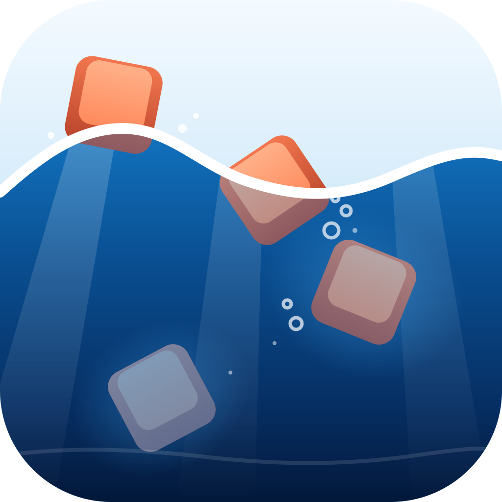

### <br>

<p align="center">
  

  <h3 align="center">
	파도 입력기 · パドIME
  </h3>

  <p align="center">
	An input method for multilinguals, on Windows.
  </p>
</p>

### <br>

**pado ime** is [bada ime](https://github.com/team-mirae/bada-ime) on Windows. It's a fork of bada ime
with the macOS shell taken out and a Windows (TSF) input method in its place, hosted by
[bada-windows](https://github.com/team-mirae/bada-windows). The engine, the layouts and every feature
are bada's, and bada's updates come downstream (see [Staying a fork](docs/windows.md#staying-a-fork)).

The name is the same idea: bada (바다) is the sea, pado (파도) is a wave on it. The layouts keep their
names: **bada** (13) and **bada roman** (15).

### Why this was built

Multilingual typing is an afterthought in most IMEs. Even JIS, which has keys dedicated to language
actions, does not take into account that the user may want to type a language other than English or
Japanese.

In bada, and so in pado, multilingual typing is why the IME exists at all.

There are two modes: **muhenkan** and **henkan**, as on Japanese keyboards. Henkan mode, entered with
**変換**, types every candidate layout you've set up at the same time, ranks the readings and shows you
the candidates.

<picture>
  <source media="(prefers-color-scheme: dark)" srcset="docs/images/layouts/qwerty-bada-kana-dark.png">
  
</picture>

QWERTY (0), bada (13) and Japanese Kana (20) all typed in henkan mode: `3`, `u`, `q` give `3uq`
(QWERTY), `쪄ㅃ` (bada) and `あなた` (kana) at the same time, ranked. Only the Japanese is a legible
phrase, so it ranks first.

<picture>
  <source media="(prefers-color-scheme: dark)" srcset="docs/images/layouts/qwerty-bada-roman-kana-dark.png">
  
</picture>

QWERTY (0), bada roman (15) and Japanese Kana (20): `g`, `w`, `i`, `h`, `a` give `gwiha` (QWERTY),
`귀하` (bada roman) and `きてにくた` (kana). Korean makes the most sense, so it ranks first.

[**Try bada in a browser**](https://bada.sjun.me/): the same engine.

### bada

bada (13) was designed so that your wrists never have to move: all movement is your fingers, up and
down or left and right. That means less strain, and once you're fluent, less fatigue. Don't expect
faster typing; for that, use 3-set unshifted (14), which allows NKRO typing (모아치기).

### bada roman

bada roman (15) types Korean with roman letters. It started as a joke and turned out surprisingly good.
If you type mostly in English and only sometimes in Korean, it's a very good setup. It leaves your
2-set (KTS) muscle memory alone: you learn which letters map to which jamo, not new key positions.

### How to install

Build from source on Windows 10 or 11 (x64). You need Visual Studio 2022 Build Tools (C++) and Rust
with the 32-bit target. Details in [docs/windows.md](docs/windows.md#install).

```powershell
git clone https://github.com/team-mirae/pado-ime; cd pado-ime
rustup target add i686-pc-windows-msvc
windows/build.ps1
windows/install.ps1
```

Then pick **pado ime** with Win+Space (under 日本語), and restart apps that were running.

### How to type

| Key | |
|---|---|
| **変換** | Henkan mode. The best candidate shows as you type; **Space** commits it |
| **Tab**, **↓**, **変換** | The next candidate. **⇧Tab**, **↑**, **⇧変換**: back |
| **⇧Enter** | Commits what shows, and nothing else |
| **Esc** | Commits too. It doesn't cancel, unlike most IMEs |
| **無変換** | Muhenkan mode: plain QWERTY |
| **カタカナ/ひらがな** | Henkan in its own profile (Settings → Profiles) |

The taskbar shows **파** in henkan and **A** in muhenkan. Right-click it for the menu and **Settings…**.

### Henkan profiles

One henkan is not always enough. Turn on Settings → Profiles, and **変換**, **カタカナ** and an Apple
keyboard's **かな** each get their own set of layouts:

| Key | Layouts |
|---|---|
| 変換 | QWERTY + bada roman |
| カタカナ | QWERTY + Japanese Kana |
| かな (Apple) | Symbols + Unicode |

### Your dictionary

pado ranks candidates by how common the words are, and your own words may not be. Put them in
`%APPDATA%\bada-windows\pado\dictionary.json` (Settings → Dictionary, or the menu's Open Dictionary
Folder), with the words you never mean. The format: [docs/dictionary-contract.md](docs/dictionary-contract.md).
Settings export to the same `bada-settings/1` file as bada's on the Mac.

### Learn Korean

[learn.sjun.me](https://learn.sjun.me) teaches you to type Korean by typing: bada roman, 2-set or bada,
from the first lesson. Same engine.

### Layouts

| Id | Layout | |
|---|---|---|
| 0 | QWERTY | muhenkan, and English in henkan |
| 10 | Korean (2-set) | KTS, the standard Korean keyboard |
| 11 | Korean (legacy-korean) | from JIS Korean |
| 12 | Korean (legacy-moonshot) | from JIS Moonshot |
| 13 | Korean (bada) | [docs/layouts/13-bada.md](docs/layouts/13-bada.md) |
| 14 | Korean (3-set JIS) | 세벌식 for JIS, 모아쓰기 |
| 15 | Korean (bada roman) | [docs/layouts/15-bada-roman.md](docs/layouts/15-bada-roman.md) |
| 18 | Korean (Roman) | Korean in romanization |
| 19 | Korean (Kana) | Korean in kana |
| 20 | Japanese (Kana) | JIS kana, with kanji conversion |
| 21 | Japanese (Romaji) | romaji, with kanji conversion |
| 150 | Symbols | symbols and emoji by name |
| 151 | Unicode | any character by its Unicode name |

Every layout and its rules: [docs/layouts](docs/layouts/README.md). bada's spec: [docs/spec.md](docs/spec.md);
what differs on Windows: [docs/windows.md](docs/windows.md).

### For developers

| Path | What |
|---|---|
| `engine/` | bada's core, in Rust. All behaviour lives here. `cargo test` |
| `windows/host/` | [bada-windows](https://github.com/team-mirae/bada-windows), the TSF host (a subtree) |
| `windows/pado/` | pado's manifest and the engine as `pado_engine.dll` |
| `windows/settings/` | `pado-settings.exe`, the settings window |
| `web/` | [bada.sjun.me](https://bada.sjun.me): the engine in WebAssembly |
| `docs/` | bada's spec, the layouts and their history; [windows.md](docs/windows.md) |
| `tools/`, `utils/` | Analysis, the layout renderer, the learner app |

### License

MIT © Mirae Research. `windows/host` (bada-windows) is CC0. The data's licenses: `engine/data/LICENSE-*`.
