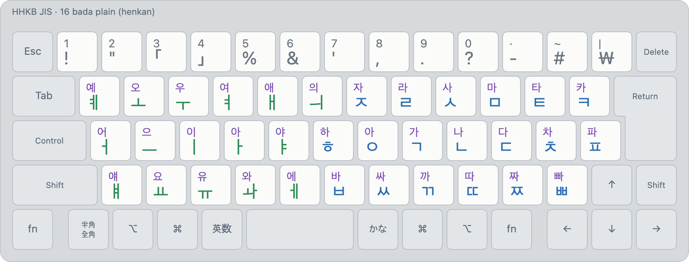

# bada plain (layout 16)

<!-- layout metadata -->
| | |
|---|---|
| **Name** | English: bada plain · 한국어: 바다 플레인 · 日本語: バダ プレーン |
| **Native script** | Korean (Hangul) |
| **Short name** | English: bada plain · 한국어: 바다 플레인 · 日本語: バダプレーン |
| **In-code name** | `bada-plain` (id 16, `layout::BADA_PLAIN`) |
| **Reliability** | Korean: **perfect** ([typing robot](../robot.md#reliability)) |
| **Abbreviations** | plain |
| **Designer** | Min Jun Sung (Mirae Research) |
| **Maintainer** | Mirae Research (미래 리서치) |
| **Contact** | mj@teammirae.com (Mirae Research); issues at https://github.com/team-mirae/bada-ime |

<picture>
  <source media="(prefers-color-scheme: dark)" srcset="../images/layouts/16-bada-plain-dark.png">
  
</picture>

| Id | Display name | Kind |
|---|---|---|
| 16 | `Korean (bada plain)` | henkan, deterministic |

Legends: bottom of a key unshifted, top with Shift. Colours: blue consonant (initial or final),
green vowel, purple syllable.

## What it is

A Korean layout for JIS keyboards with **every vowel under the left hand and every consonant under
the right**, one jamo to a key. It is a candidate to replace bada ([13](13-bada.md)) as bada ime's
own layout (owner, 2026-11-12), and the **default henkan candidate** ([spec §5.3](../spec.md)). It's
**deterministic**: the same keys always give the same text. The Keyboard Viewer shows its legends in
henkan mode (`mac/tools/make-keylayout.swift`).

Code: `engine/src/layout.rs` (`bada_plain`), composed by the same rules as 2-set.

## Keys and rules

Unshifted on the first line of each row, ⇧ on the second:

| | `1` | `2` | `3` | `4` | `5` | `6` | `7` | `8` | `9` | `0` | `-` | `^` | `¥` |
|---|---|---|---|---|---|---|---|---|---|---|---|---|---|
| key | ! | " | ｢ | ｣ | % | & | ' | , | . | ? | - | # | ₩ |
| ⇧ | 1 | 2 | 3 | 4 | 5 | 6 | 7 | 8 | 9 | 0 | · | ~ | \| |

| | `Q` | `W` | `E` | `R` | `T` | `Y` | `U` | `I` | `O` | `P` | `@` | `[` |
|---|---|---|---|---|---|---|---|---|---|---|---|---|
| key | ㅖ | ㅗ | ㅜ | ㅕ | ㅐ | ㅢ | ㅈ | ㄹ | ㅅ | ㅁ | ㅌ | ㅋ |
| ⇧ | 예 | 오 | 우 | 여 | 애 | 의 | 자 | 라 | 사 | 마 | 타 | 카 |

| | `A` | `S` | `D` | `F` | `G` | `H` | `J` | `K` | `L` | `;` | `:` | `]` |
|---|---|---|---|---|---|---|---|---|---|---|---|---|
| key | ㅓ | ㅡ | ㅣ | ㅏ | ㅑ | ㅎ | ㅇ | ㄱ | ㄴ | ㄷ | ㅊ | ㅍ |
| ⇧ | 어 | 으 | 이 | 아 | 야 | 하 | 아 | 가 | 나 | 다 | 차 | 파 |

| | `Z` | `X` | `C` | `V` | `B` | `N` | `M` | `,` | `.` | `/` | `\` |
|---|---|---|---|---|---|---|---|---|---|---|---|
| key | ㅒ | ㅛ | ㅠ | ㅘ | ㅔ | ㅂ | ㅆ | ㄲ | ㄸ | ㅉ | ㅃ |
| ⇧ | 얘 | 요 | 유 | 와 | 에 | 바 | 싸 | 까 | 따 | 짜 | 빠 |

- **A consonant is an initial or a final**, as in 2-set: after a vowel it's a final, and a vowel
  after it takes it as its initial (ㄱ ㅏ ㄴ ㅏ → 가나). Two finals cluster (ㄹ ㄱ → ㄺ: 닭). ㄲ and ㅆ
  are finals too; ㄸ ㅉ ㅃ are initials only.
- **A vowel alone starts on ㅇ** (implied ㅇ): ㅏ ㅣ → 아이, ㄱ ㅏ ㅣ → 가이. The ㅇ key (J) is for
  the final ㅇ and for an ㅇ a vowel wouldn't get by itself.
- **The same vowel key twice puts a final back** (owner, 2026-11-12; as [11](11-korean-legacy.md)
  and [12](12-moonshot.md)): ㅁ ㅏ ㄹ ㅣ is 마리, and ㅣ again right away makes it 말이. Only the first
  repeat does it (a third ㅣ: 말이이).
- **Compound vowels join:** ㅗ ㅏ → ㅘ (also its own key, V), ㅗ ㅐ → ㅙ, ㅗ ㅣ → ㅚ, ㅜ ㅓ → ㅝ,
  ㅜ ㅔ → ㅞ, ㅜ ㅣ → ㅟ, ㅡ ㅣ → ㅢ (also Y).
- **⇧ + a vowel starts a syllable on ㅇ**, whatever is before it (JIS Moonshot's rule,
  [12](12-moonshot.md)): 한국 then ⇧ㅓ → 한국어, where a plain ㅓ takes the ㄱ (한구거); ㄱ ㅜ ⇧ㅓ →
  구어, where a plain ㅓ joins (궈). Typing the ㅇ does the same (ㄱ ㅜ ㄱ ㅇ ㅓ). When an initial is
  waiting for its vowel, ⇧ changes nothing (ㄱ ⇧ㅏ → 가).
- **⇧ + a consonant is it and ㅏ** (JIS Moonshot's rule): ⇧ㄱ → 가, ⇧ㅇ → 아.
- **What ⇧ types is a syllable still open**, not a finished one: finals go on it and vowels join it
  as if its jamo had been typed one by one (⇧ㄱ ㄴ → 간, ⇧ㄷ ㄹ ㄱ → 닭, ⇧ㅏ ㄴ → 안, ⇧ㅗ ㅏ → 와,
  ⇧ㅜ ㅓ ㄴ → 원), and a vowel after it takes a final back (⇧ㄱ ㄴ ㅏ → 가나).
- **The number row is punctuation:** ! " ｢ ｣ % & ' , . ? - # ₩ (! " and ' where JIS has them on ⇧).
  With ⇧: the digits, and · ~ | on
  `-` `^` `¥`. `3` and `4` type the half-width corner brackets ｢ ｣ (U+FF62, U+FF63; owner,
  2026-11-12), not the 「 」 that 11 and 15 type.
- **⇧⌥ + a number or symbol key** types its shifted JIS character, as in every Korean layout
  (⇧⌥8 `(`, ⇧⌥9 `)`, ⇧⌥- `=`, ⇧⌥; `+`). ⌥ without ⇧ isn't the layout's: what's staged is committed
  and the key goes to the app.
- **Not in henkan:** `/` `:` `;` `@` `[` `]` `\` `^` `¥`. Type them in muhenkan (英数).
- **No typo suggestions and no predictions** (owner, 2026-11-12): those are bada's
  ([13](13-bada.md) §5, §6).

Examples: 감사합니다 K F P O F H F N L D ; F · 한국어 H F L K E K ⇧A · 가족 ⇧K U W K · 닭 ; F I K ·
말이 P F I D D.

### F-key actions

Bound to nothing by default ([spec §6.5](../spec.md)).

| Action | Does |
|---|---|
| `qwerty-fullwidth` | The staged keys as JIS QWERTY, full-width (ｈｆｌ). Lasts until the commit |
| `qwerty-halfwidth` | The same, half-width (hfl) |
| `initials` | Keeps each syllable's initial consonant: 한국 → ㅎㄱ. On the staged text, which stays staged with typing going on after it; with nothing staged, on the selection |
| `vowels` | Keeps each syllable's vowel: 한국 → ㅏㅜ. The same way |
| `finals` | Keeps each syllable's final consonant, syllables without one dropped: 한국 → ㄴㄱ. The same way |
| `commit-bare` | Commits this layout's reading as typed with the implied ㅇ dropped: ㄱ ㅏ ㅓ → 가ㅓ, ㅗ ㅏ → ㅘ. An ㅇ that was typed or asked for with ⇧ stays, and so does a syllable with a final (안) |

The QWERTY actions are bada's ([13](13-bada.md) §6), the jamo actions bada roman's
([15](15-bada-roman.md)), and `commit-bare` is the legacy layouts' ([11](11-korean-legacy.md)).

## Beside other layouts

In a set the first row is right about as often as with bada ([robot.md](../robot.md#layout-sets)):
beside QWERTY 99.7% for both, beside QWERTY and kana 94.0% against 93.9%. On held-out text it is
0.0 to 0.3 points behind (beside QWERTY 99.3% against 99.6%). While a word is being typed beside
QWERTY the screen is a little less steady: it shows what the layout shows alone after 91.9% of the
presses, 94.8% for bada. The key models by themselves ([spec §7.0](../spec.md)) tell its words from
English and from romaji less surely than bada's: 97.7% and 97.8% of held-out words, against 99.9% and
100.0% (the model builder's report).

The keycaps for QWERTY, bada plain and kana together are in
[combinations](combinations.md#qwerty--bada-plain--kana).

## Tools

Key map: `16-bada-plain.json`, written from the engine by `cargo run --example layout_json` (in
`engine/`). The layout was drawn in the layout editor (`tools/editor`, id 300 there).

Images: `python3 tools/render/export_png.py` (HHKB JIS). Interactive: open `tools/render/index.html`.
